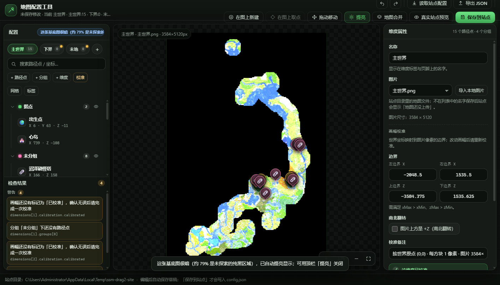

# Steve Server 地图配置工具

一个**零依赖的本地网页工具**：在浏览器里可视化编辑 [SteveServerMap](https://github.com/) 站点的 `config.json` —— 维度、基底图、画幅校准、分组、路径点 —— 用**真实站点**实时预览效果，确认无误后一键写回站点仓库。

不用 `npm install`，不用构建，双击 `start.cmd`（或 `node server.mjs`）就能用。

> ⚠️ **必须通过本地服务器打开（http://127.0.0.1:5273/），不要直接双击 index.html。**
> 浏览器不允许在 ile:// 下加载 ES Module，直接双击只会看到一页空白（地图区没有图）。
> 正确姿势：双击 start.cmd → 它会自动打开浏览器；或在该目录执行 
ode server.mjs 后访问 <http://127.0.0.1:5273/>。



---

## 前置要求

| 项目 | 要求 |
| --- | --- |
| Node.js | **18 或更新**（推荐 20 / 22 / 24；用 `node --version` 检查） |
| 浏览器 | 新版 Edge / Chrome / Firefox / Safari（需要原生 ES Module） |
| 站点仓库 | 与工具目录同级：`../SteveServerMap.github.io`（或启动时用 `--site=` 指定） |
| 依赖 | **无**。不需要 `npm install`，不需要联网 |

> 工具只读写 `127.0.0.1` 上的本地文件，不会上传任何东西；真正发布靠你自己 `git push`。

---

## 启动

把工具仓库（`SteveServerMapConfig`）和站点仓库（`SteveServerMap.github.io`）放在同一个目录下：

```
D:\Project\Github\
├─ SteveServerMapConfig\          ← 本工具
└─ SteveServerMap.github.io\      ← 站点（config.json / 地图 png）
```

**方式一：双击 `start.cmd`**（Windows 最省事），然后浏览器打开 <http://127.0.0.1:5273/>。

**方式二：命令行**

```bash
node server.mjs
# → http://127.0.0.1:5273/

# 换端口 / 指定站点目录
node server.mjs --port=5300 --site="D:/Project/Github/SteveServerMap.github.io"

# 换草稿目录（默认 <工具目录>/.data，脚本/测试隔离时用）
node server.mjs --data="D:/tmp/ssm-draft"
```

也可以用环境变量：`SSM_PORT`、`SSM_SITE`、`SSM_DATA`。停止服务用 `Ctrl + C`。

也可以用 `npm start` / `npm test`（`package.json` 里已配好，**没有依赖，不需要 `npm install`**）。

启动后页脚会显示实际使用的站点目录；如果站点目录不存在，保存会失败并给出提示。

---

## 界面说明

```
┌──────────────────────────────────────────────────────────────────────┐
│ 顶栏：文件标题 · 撤销/重做 · 读取站点配置 · 导出 JSON · 预览 · 保存   │
├───────────────┬──────────────────────────────────┬───────────────────┤
│ 左：配置树     │ 中：编辑画布                      │ 右：属性表单       │
│ · 维度标签页   │ · 地图图片 + 路径点标记           │ · 路径点 / 分组 /  │
│ · 搜索框       │ · 滚轮缩放 / 拖拽平移 / 整图      │   维度 / 站点字段  │
│ · 分组 + 路径点│ · 缩放按钮、坐标读数、网格        │ · 新增 / 删除 / 复制│
│ · 检查结果     │                                  │                   │
├───────────────┴──────────────────────────────────┴───────────────────┤
│ 页脚：站点目录 · 自动保存/保存状态提示                                │
└──────────────────────────────────────────────────────────────────────┘
```

- **顶栏**
  - `撤销 (Ctrl+Z)` / `重做 (Ctrl+Shift+Z)`
  - `读取站点配置`：重新从站点目录读取 `config.json`（会丢弃未保存修改，也会顺带丢弃浏览器里的草稿）
  - `导出 JSON`：把当前草稿下载成 `config.json`（2 空格缩进 + 结尾换行）
  - `真实站点预览`：用站点自己的页面 + 当前草稿渲染（不写盘）
  - `保存到站点`：写回站点仓库的 `config.json`（写前自动备份）。有 error 时会被拦下
- **左侧配置树**
  - 维度标签页：切换维度；末尾 `+` 新建维度
  - 搜索框：按名称、描述、坐标搜索路径点（规则与站点侧一致，支持 `-512 640` 这种坐标前缀匹配）
  - 树顶部按钮：`+ 路径点`、`+ 分组`、`校准`、`+ 维度`
  - 每个路径点行右侧有「复制」「删除」按钮；分组可折叠、可切换显隐（眼睛图标）
  - 底部「检查结果」：红点 = error（禁止保存），黄点 = warning；点一条问题会跳到对应维度 / 分组 / 路径点 / 字段
- **中间画布**
  - 滚轮以光标为锚点缩放；按住空白处拖拽平移；双击放大
  - 右下角 `+` / `−` / 整图按钮；键盘 `+` `-` 缩放、方向键平移
  - 拖动标记即可微调世界坐标（松手后坐标四舍五入到整数方块）
  - 光标处实时显示世界坐标读数；可切换网格
- **右侧属性表单**
  - 选中路径点 / 分组 / 维度 / 站点时显示对应字段
  - 所有修改即时生效、即时校验、自动保存草稿

---

## 新增 / 编辑路径点

### 新增

1. 在左侧选中要添加路径点的**维度**。
2. 点配置树顶部的 **`+ 路径点`**。
   - 新路径点会落在**图片中心**对应的世界坐标上（自动取整），并自动选中、在右侧打开属性表单。
   > **想拖动路径点？** 默认**不能**直接拖（避免误拖），需要先点顶栏 **`拖动移动`** 打开开关；
   > 或者按住 **Alt** 键再拖（临时启用，不用开开关）。
   >
3. 选择落点（三选一）：
   - **点哪里建哪里**：先点顶栏 **`在图上新建`**，再在地图上点一下 → 就在那里新建一个路径点（`Esc` 取消）；
   - **先建再定位**：直接点 `+ 路径点` 会在**当前视图中心**建一个点（一定在屏幕里），再点顶栏 `在图上取点` → 在地图上点一下把**选中的**路径点挪过去；
   - **直接改数字**：在右侧表单里填 `X / Z`，或拖动标记。

   > 注意：**点击左侧列表或画面里的路径点只会选中它并在右侧打开属性**，不会进入「下一次点地图就移动」的状态 ——
   > 想移动必须显式点 `在图上取点`（或直接拖标记）。切换选中会自动取消待放置状态。

4. 调整位置：
   - 直接在地图上**拖动标记**微调（松手后坐标写回表单）；
   - 或在右侧表单直接改 `X / Z`；
   - 也可以进入**放置模式**后在地图上点一下，把坐标写到该位置（画布左上角会显示「放置模式：点击地图放置路径点」；按 `Esc` 退出）。
4. 右侧表单填写：
   - **名称**（必填）
   - **X / Y / Z**：世界坐标；Y 可留空（站点会省略 Y）。也可以在画布上**直接拖动标记**微调，拖动结束后坐标写回表单。
   - **分组**：决定颜色与显隐，默认「未分组」
   - **图标**：内置图标选择器（🧷 🏠 🏘️ 🌾 ⛏️ 🌀 …），也可以填 1~2 个字符的 emoji 自定义
   - **颜色**：覆盖分组色（留空 = 跟随分组）
   - **标签策略**：跟随全局 / 始终显示 / 悬停显示 / 不显示
   - **描述**：显示在标记详情弹窗里
   - **外链**：详情弹窗里的「打开链接」
5. 保存前看左下「检查结果」，没有红点再点「保存到站点」。

### 编辑 / 复制 / 删除

- 在树里点路径点 → 右侧改字段；改完即时生效。
- 路径点行右侧 **复制**：复制出一个同坐标、同分组、名称带「（副本）」的新路径点（id 自动保证唯一）。
- 路径点行右侧 **删除**（或选中后按 `Delete`）：会二次确认。
- 搜索框输入名称 / 坐标可快速定位；搜到的路径点会在地图上高亮过滤。

---

## 新增分组 / 维度

### 分组

- 配置树顶部 **`+ 分组`**，或在维度属性表单里 **`+ 新建分组`**。
- 右侧分组属性：名称、颜色（`#rrggbb`）、是否在画布上显示。
- 删除分组时，组内路径点会自动归入「未分组」，不会跟着被删。
- 「未分组」是默认分组，用来接住没有指定分组的路径点。

### 维度

- 配置树顶部 **`+ 维度`**（或维度标签页末尾的 `+`）。
- 新维度建好后需要做两件事：
  1. **选基底图**：在维度属性里从站点图片列表选择，或点「导入本地图片」（会把图片写进站点目录，同名文件自动备份）。
  2. **校准画幅**：见下一节。
- 维度字段：`id`（用于链接参数与默认维度，改之前想清楚）、名称、图片、画幅四边界 / `flipZ` / 备注、是否默认维度。
- 删除维度会连同该维度的路径点一起删除；至少保留一个维度。

---

## 画幅校准（重点）

> 一句话：**路径点永远存世界坐标（方块），图片像素只是「画幅」的函数**。
> 所以换图、裁剪、改分辨率都不影响路径点；只要重新校准一次，所有点自动回到正确位置。

### 什么时候需要校准

- 第一次给维度配图时；
- 换了基底图（重新导出、裁剪范围变了、分辨率变了）；
- 发现所有路径点整体偏移 / 上下颠倒 / 被拉伸时。

### 方式一：两点拾取（推荐）

1. 选中维度，点配置树顶部 **`校准`**（或维度属性里的「去校准」）。
2. 在图上点两个**你知道精确世界坐标**的地标（例如出生点 `0,0`、城堡中心、下界传送门），分别填它们的世界 `X / Z`。
   - 两个点尽量拉开距离，不要在同一行或同一列。
3. 工具会反推出整幅图的 `xMin / xMax / zMin / zMax`，并实时预览。
4. 点「应用并关闭」写入草稿；再点「保存到站点」才会写进 `config.json`。

### 方式二：只在图上点「世界原点 (0,0)」（最省事）

对话框下半部分有「**或者：只指定世界原点 (0,0)**」：

1. 点「**拾取原点**」→ 在地图上点一下世界坐标 **(0,0)** 所在的那一格（出生点附近；也可以是你确知的任意 `(0,0)` 参照点）；
2. 「每方块像素数」默认按当前画幅推算：多数离线图填 `1`；如果渲染时放大过，例如一张 7168px 宽、覆盖 3584 方块的图就是 `2`；
3. 图上方是 `+Z` 时勾「南北翻转」；
4. 下方实时显示解出的 `X：… → …`、`Z：… → …`，确认后点「**按原点应用**」。

换算公式：`每像素方块数 = 1 / 每方块像素数`，
`xMin = -原点px × 每像素方块数`、`xMax = xMin + 图宽 × 每像素方块数`；Z 方向同理（翻转时以 `+Z` 在上为基准）。

> 只用到一个点，所以**倍率必须填对**；不确定就先用两点法校一次，再回来看这里的默认值。
> 这个模式对「只知道出生点在哪、懒得找第二个地标」的场景最友好。

### 方式三：手填四边界

在维度属性表单的「画幅校准」里直接填：

| 字段 | 含义 |
| --- | --- |
| `xMin` | 图片**左边缘**对应的世界 X |
| `xMax` | 图片**右边缘**对应的世界 X |
| `zMin` | 世界 Z 的**最小值**（永远小于 `zMax`） |
| `zMax` | 世界 Z 的**最大值** |
| `flipZ` | 图片上方是 `zMax`（南北翻转）时勾选；默认 `false` 表示图片上方是 `zMin` |
| `calibrated` | 校准确认标记；未勾选时工具只给 warning，不拦保存 |
| `note` | 备注，记录校准依据 |

换算关系（站点 `coords.js` 的同一套公式）：

```
px = (x - xMin) / (xMax - xMin) * 图片宽
py = (z - zMin) / (zMax - zMin) * 图片高     // flipZ=true 时 py 上下翻转
```

### 「换图后重新校准、路径点不丢」的原理

1. `config.json` 里每个路径点只存 `x / z`（世界坐标），**不存像素坐标**；
2. 图片像素坐标 = 世界坐标经过当前 `calibration` 线性映射的结果；
3. 重新导出地图后，图片的宽高 / 覆盖范围变了，但地标在世界里的位置没变；
4. 你只需重新做一次校准（两点或四边界），映射参数更新，所有路径点立刻回到正确像素位置；
5. 整个过程不修改任何路径点数据，所以**不会丢点、不会偏移**。

> 小提示：工具会在「X 方向和 Z 方向的方块/像素比例相差超过 3%」时给一条 warning（原点模式只有一个点，无法做这个交叉校验，所以倍率一定填准），
> 通常意味着校准填错了（多数地图两个方向的比例应该一致）。

---

## 预览

点顶栏 **`真实站点预览`**：

- 工具会把当前草稿导出成配置，通过一次性 token 交给站点页面（`/preview/index.html?token=…`）；
- iframe 里跑的是**站点自己的代码**（`coords.js` / `markers.js` / `viewer.js`），和线上效果一致；
- 预览**不会**写入站点目录，可以随便改、随便看；
- 预览里点「刷新」可重新加载当前草稿。

---

## 保存与回滚

### 草稿自动保存

- 每次编辑后约 0.8 秒，草稿会自动保存到工具目录的 `.data/draft.json`；
- 下次启动工具会自动恢复这份草稿（页脚/顶栏会提示）；
- 想丢弃草稿、回到站点真实配置：点 `读取站点配置`，或直接删掉 `.data/draft.json` 再刷新页面。

### 保存到站点

点顶栏 **`保存到站点`**（或 `Ctrl+S`）：

1. 先做一次完整校验；**有 error 时不会写盘**，会提示去看左下「检查结果」；
2. 服务端在写入前把旧的 `config.json` 复制一份：
   `config.json.bak-<时间戳>`（例如 `config.json.bak-20251105-031500`）；
3. 再写入新的 `config.json`（2 空格缩进 + 结尾换行，UTF-8）；
4. 保存成功后提示备份文件名。

> 导入同名图片时也会备份：`<图片名>.bak-<时间戳>`。

### 发布到线上（提交 + 推送）

工具不会自动执行 git。保存后自己提交站点仓库：

```powershell
cd D:\Project\Github\SteveServerMap.github.io
git add -A
git commit -m "update config"
git push
```

一条命令版本（可直接粘进终端）：

```powershell
git -C "D:\Project\Github\SteveServerMap.github.io" add -A && git -C "D:\Project\Github\SteveServerMap.github.io" commit -m "update config" && git -C "D:\Project\Github\SteveServerMap.github.io" push
```

GitHub Pages 通常 1~2 分钟内生效；本地预览刷新即可看到（浏览器缓存用 `Ctrl+F5`）。

### 误改之后怎么恢复

| 情况 | 恢复办法 |
| --- | --- |
| 站点 `config.json` 改坏了 | 用备份覆盖：`Copy-Item config.json.bak-20251105-031500 config.json -Force` |
| 已经提交过 | `git -C <站点目录> restore config.json`（旧版 git：`git checkout -- config.json`） |
| 草稿改乱了 | 删除 `.data/draft.json`，刷新页面 → 自动回到站点 `config.json` |
| 图片被覆盖了 | 用 `<图片名>.bak-<时间戳>` 覆盖回去 |

---

## 常见问题

**Q：地图不显示 / 浏览器 404（「地图还没上传」）**
- 检查 `config.json` 里的 `image` 是否与站点目录里的文件名**完全一致**（大小写敏感，GitHub Pages 尤其严格）；
- 只支持 `png / jpg / jpeg / webp`；
- 图片要放在**站点仓库根目录**（与 `config.json` 同级）；
- 最省事：在维度属性里点「导入本地图片」，工具会自动写入站点目录并记录尺寸；
- 确认启动参数 `--site=` 指向的是正确的站点目录（看页脚）。

**Q：路径点整体偏移 / 上下颠倒 / 被拉伸**
- 多半是画幅没校准或校准过期：重新用「两点校准」核对一次；
- 上下颠倒 → 检查 `flipZ`（图片上方是 +Z 时要勾选）；
- 整体平移偏一段固定距离 → 校准用的两个地标坐标填错了（注意主世界 / 下界 / 末地坐标不是同一套）；
- 被拉伸 → 四边界跨度与图片宽高比例不一致，按提示重新校准。

**Q：启动报端口被占用（`EADDRINUSE`）**
- 换端口：`node server.mjs --port=5300`；
- 或找出占用进程：`netstat -ano | findstr :5273`，再 `taskkill /PID <PID> /F`；
- 也可能只是上一次的服务还开着，关掉那个终端窗口即可。

**Q：保存被阻止 / 提示有 error**
- 左下「检查结果」里带红点的是 error（例如：维度 id 为空或重复、路径点名称为空、`x/z` 不是数字、画幅倒置、颜色不是 `#rrggbb`、缺少基底图）；
- 点一下问题条目会跳到对应位置，改完红点消失即可保存；
- 黄点 warning 不拦保存，但建议处理（例如：还没校准、图片不存在、空分组）。

**Q：打开工具后「地图区是空的 / 没有地图」**
按顺序排查：

1. **是不是双击 `index.html` 打开的？** 那会看到「这个工具必须通过本地服务器打开」的提示页 —— 按提示用 `start.cmd` 或 `node server.mjs`，再访问 <http://127.0.0.1:5273/>。
2. **画布左上角有没有信息条**（如 `主世界 · 主世界.png · 3584×5120px`）？有信息条说明图片已加载成功，此时如果还是「一片黑」，那是**基底图本身很暗**（离线渲染常见：未探索区域是纯黑，主世界这张图 79.6% 是纯黑），点顶栏「**提亮**」即可；工具也会在检测到暗图时自动提亮。
3. **信息条没有、画布提示「找不到基底图」**：站点目录不对。看页脚显示的「站点目录」，用 `--site=` 指到 `SteveServerMap.github.io` 的绝对路径。
4. 站点目录里确实没有那张 PNG：检查 `config.json` 的 `image` 字段和文件名是否完全一致（含大小写、扩展名）。

> 历史 bug（v1 已修）：早期版本 `tool.css` 用 `.canvas-image{opacity:0}` + `.is-loaded{opacity:1}` 做淡入，但 `canvas.js` 从未加 `is-loaded`，导致图片在 DOM 里、尺寸也对、就是画不出来。如果你手上是旧版本，`git pull` 后 `Ctrl+F5` 即可。

**Q：地图很暗 / 看不清地表**
点顶栏「**提亮**」按钮（`brightness(2.8) saturate(1.15)`）。工具会按缩略图统计自动判断：亮像素占比 < 45% 或平均亮度 < 42 时自动开启；手动选择会记在浏览器 `localStorage`，可用同一个按钮关掉。

**Q：保存成功但线上没变化**
- 还没有 `git push`（工具只写本地文件）；
- 站点目录不对（看页脚显示的路径）；
- GitHub Pages 有延迟，或用 `Ctrl+F5` 强刷浏览器缓存。

**Q：保存后 `config.json` 顶部的 `$schema` 还在吗**
- 在。工具会记住站点 `config.json` 里原有的 `$schema` 值，并在保存时原样写回第一行（它只用于编辑器补全，站点运行不依赖它）。如果原文件没有 `$schema`，保存后也不会有。

---

## 目录结构

```
SteveServerMapConfig/
├─ start.cmd                 双击启动（Windows）
├─ package.json              只声明 "type": "module" 与 npm 脚本，无依赖
├─ server.mjs                零依赖本地服务器：静态托管 + 编辑 API + /preview 站点挂载
├─ index.html                工具页面骨架
├─ merge.html                地图合并页面骨架
├─ assets/
│  ├─ css/
│  │  ├─ tool.css            深色 Minecraft 风格主题
│  │  └─ merge.css           地图合并页样式
│  └─ js/
│     ├─ app.js              装配层：状态 / 撤销重做 / 保存 / 预览
│     ├─ model.js            草稿模型：规范化 / 校验 / 导出（纯函数，可 node 下测试）
│     ├─ canvas.js           编辑画布：平移缩放 / 标记拖拽 / 校准拾取
│     ├─ editor.js           左侧配置树 + 右侧属性表单 + 问题面板
│     ├─ merge.js            地图合并页控制器
│     ├─ merge-core.js       合并算法（纯函数，可 node 单测）
│     └─ merge-ui.js         合并页界面层（canvas / 统计 / 控件）
├─ tests/
│  ├─ merge-core.test.mjs    地图合并算法单测（node --test）
│  ├─ merge-e2e.mjs          地图合并端到端（无头浏览器）
│  ├─ fixtures/              合并测试素材（base.png / incoming.png）
│  ├─ model.test.mjs         model 单元测试（node --test）
│  ├─ e2e.mjs                端到端验收（无头浏览器，零依赖）
│  └─ artifacts/             测试截图 / 报告（已被 git 忽略）
├─ docs/
│  ├─ CONTRACT.md            内部接口契约（开发者）
│  ├─ MERGE.md               地图合并的接口契约
│  ├─ MERGE-QA.md            地图合并验收记录
│  ├─ QA.md                  验收记录
│  └─ screenshot-tool.png    界面截图
├─ README.md
└─ .data/draft.json          自动保存的草稿（运行时生成，已被 git 忽略）
```

---

## 地图合并（`/merge.html`）

用来把**别人给你的地图 PNG** 和你站点正在用的地图对齐、比较、合并 —— 适合「他从别的地方跑图，你这边缺一块」的场景。

### 打开方式

工具页顶栏点 **`地图合并`**（会在新标签页打开 `http://127.0.0.1:5273/merge.html`）。

### 使用步骤

1. **目标图**：默认自动载入站点 `config.json` 里第一个维度的地图（也可以点「点击选择 / 拖入 PNG」换成别的文件）；
2. **新图**：把别人给的 PNG 拖到右侧区域；
3. **对齐两张图**（关键一步，决定合并准不准）：
   - 目标图通常已有站点配置好的画幅，无需再点；
   - 新图：**先滚轮放大**到能看清方块/地标（画布右下角会实时显示「图片像素 x, y」），
     再点「**拾取 (0,0)**」→ 点一下**世界坐标 (0,0)** 所在的位置 → 填「每方块像素数」（多数离线图是 `1`，两倍分辨率的图填 `2`）；
   - 觉得点得不够准？**直接改「原点像素」那两个数字**，或用 **← ↑ ↓ →** 按钮挪 1 像素 —— 改完画幅会立即重算；
   - 每张图都能独立缩放/平移（滚轮、拖拽、双击、右上角 +/−/适应）。
4. 点「**分析差异**」→ 中间预览会显示合并效果，目标图上会叠加色块：
   - 🟩 绿 = 新图有、目标图没有（**新增**，会被补进来）
   - 🟨 黄 = 两边都有但颜色差很多（**变更**，勾选「用新图覆盖变更区域」才会覆盖）
   - ⬜ 灰 = 只有目标图有（保留）
5. 按需调整页脚参数（tile 大小、空白亮度阈值、变更色差阈值）和两个开关，再点「**按策略合并**」重新合成；
6. 输出：
   - 「**下载 PNG**」把结果存到本地；
   - 「**保存到站点**」直接写回站点目录（文件名默认 = 目标图名，**写前自动备份到 `.backups/`**，并记入 `.data/save.log`）。

### 注意事项

- 两张图必须**同朝向**（上方都是 -Z，或都是 +Z）；有旋转/镜像的图不能直接合并。
- 「变更」是按**像素色差**判断的启发式：如果两张图的渲染调色板/光照不同，会满屏判成"变更"——**务必先看中间预览再点保存**。
- 建议第一次先「下载 PNG」看看效果，确认无误再「保存到站点」。
- 大图（单边 >16384 或面积 >2.68 亿像素）超出浏览器 canvas 能力，页面会直接报错。

接口契约见 [`docs/MERGE.md`](docs/MERGE.md)，验收记录见 [`docs/MERGE-QA.md`](docs/MERGE-QA.md)。

---
## 配置文件字段速查（`config.json`）

```jsonc
{
  "version": 1,
  "site": { "title": "…", "subtitle": "…", "footer": "…" },
  "defaultDimension": "overworld",
  "ui": { "labelMode": "hover", "grid": false, "startCollapsed": false, "showCoords": true },
  "dimensions": [
    {
      "id": "overworld",              // 唯一 id，用于链接参数
      "name": "主世界",                // 显示名
      "image": "主世界.png",           // 站点根目录下的图片文件名
      "calibration": {
        "calibrated": true,           // 是否已确认校准
        "xMin": -1792, "xMax": 1792,  // 图片左右边缘对应的世界 X
        "zMin": -2560, "zMax": 2560,  // 世界 Z 最小值 / 最大值
        "flipZ": false,               // 图片上方是 +Z 时置 true
        "note": "两点校准 · …"
      },
      "groups": [
        { "id": "base", "name": "据点", "color": "#5ad26f", "visible": true }
      ],
      "waypoints": [
        {
          "id": "spawn",              // 维度内唯一
          "name": "出生点",
          "x": 0, "z": 0,             // 世界坐标（必填）
          "y": 65,                    // 可选；null/省略时站点不显示 Y
          "group": "base",            // 缺省落到 default
          "icon": "spawn",            // ICONS key，或 1~2 字符 emoji
          "color": "#ff0000",         // 可选：覆盖分组色
          "label": "always",          // 可选：always | hover | never
          "description": "…",         // 可选
          "url": "https://…"          // 可选：详情弹窗里的外链
        }
      ]
    }
  ]
}
```

- 字段顺序由工具固定，便于 git diff；
- 空值字段（`y: null`、空 `color` / `url` / `description` / `label`）不会写出；
- 保存结果一定能通过站点的 `config.schema.json`；
- 工具专用字段（如 `imageMeta`）只存在于 `.data/draft.json`，**不会**写进站点配置。

---

## 给开发者

- 完整接口契约见 [`docs/CONTRACT.md`](docs/CONTRACT.md)；
- 工具是**零依赖、零构建**的：只用 Node 内置模块 + 原生 ES Module；
- 坐标数学不重复实现：服务端把站点仓库挂到 `/preview/`，前端直接 `import` 站点的 `assets/js/coords.js`；
- 单元测试（不需要安装任何东西，Node 18+ 即可；仓库里的 `package.json` 声明了 `"type": "module"`）：

  ```bash
  node --test tests/model.test.mjs
  npm test            # 等价于上一条
  ```

- 端到端验收（无头浏览器，零依赖）：

  ```bash
  node tests/e2e.mjs
  ```


